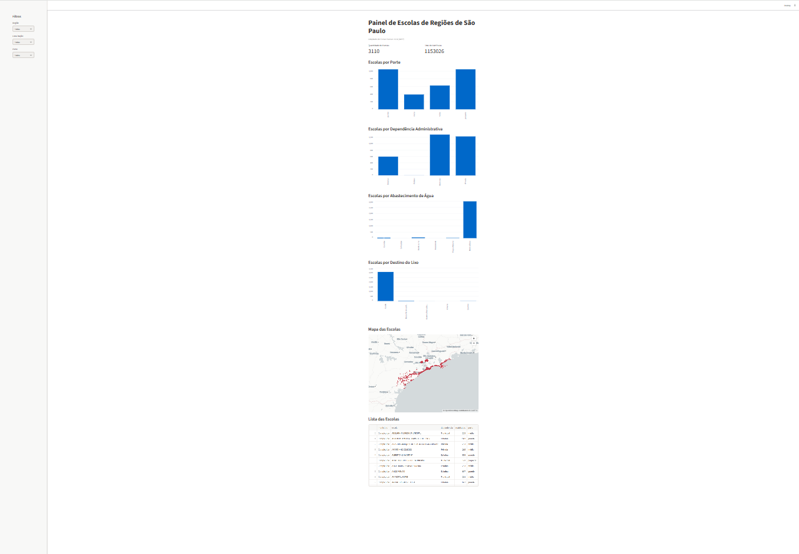
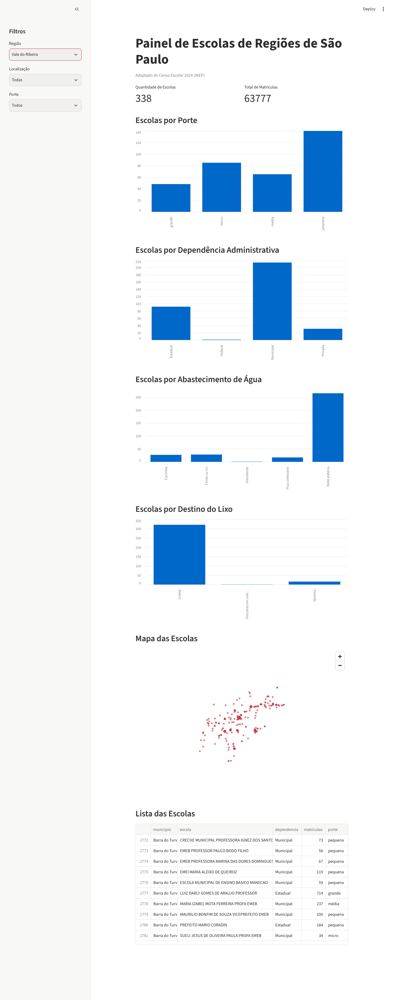

# PROJETO 4 - PAINEL INTERATIVO DO CENSO ESCOLAR EM PYTHON

## Objetivo

Construir um painel interativo com as escolas em atividade de **30 municípios de quatro regiões do estado de São Paulo** (Região Metropolitana de SP, Baixada Santista, Litoral Norte e Vale do Ribeira), a partir de uma base adaptada do Censo Escolar 2024 (INEP). O painel permite responder, por exemplo:

- Quantas escolas e quantas matrículas existem em cada região, município ou combinação de filtros?
- Como as escolas se distribuem por porte (micro, pequena, média e grande) e por dependência administrativa (federal, estadual, municipal e privada)?
- Quais são as condições de abastecimento de água e de destino do lixo das escolas?
- Onde ficam as escolas no mapa?

Ao trocar um filtro, todo o painel é recalculado com as escolas selecionadas.

## Painel em Python (pandas e Streamlit)

No Projeto 2, o painel foi feito no Excel, com tabelas dinâmicas, gráficos dinâmicos e segmentação de dados. No Projeto 4, o mesmo tipo de painel passa para o Python: o **pandas** carrega e organiza os dados e o **Streamlit** monta a página interativa, que roda no navegador a partir de um script (`painel.py`).

O que mudou em relação ao Projeto 2:

● A base deixou de ser o recorte de um município e passou a ser um arquivo CSV com escolas de 30 municípios de quatro regiões, com latitude e longitude de cada escola;

● As colunas calculadas, que no Excel eram fórmulas, passaram a ser criadas por uma função em Python (`classifica_porte`);

● A segmentação de dados foi substituída por filtros na barra lateral do Streamlit;

● As tabelas e os gráficos dinâmicos foram substituídos por contagens do pandas (`value_counts`) mostradas em gráficos de barras;

● Foi incluído um mapa em que cada escola aparece como um ponto.

### Como usar

**1. Baixar os arquivos.** Mantenha `painel.py` e `escolas_sp_regioes_2024_geo.csv` **na mesma pasta**.

**2. Instalar os pacotes** (só na primeira vez), no terminal:

```
python -m pip install pandas streamlit
```

**3. Rodar o painel.** Abra o terminal dentro da pasta dos arquivos e digite:

```
python -m streamlit run painel.py
```

O painel abre no navegador (endereço `http://localhost:8501`). Se o Streamlit pedir um e-mail na primeira vez, basta apertar Enter. Para encerrar, volte ao terminal e aperte `Ctrl + C`.

**4. Usar os filtros.** Na barra lateral esquerda há três filtros:

- **Região:** Todas, Região Metropolitana de SP, Baixada Santista, Litoral Norte ou Vale do Ribeira;
- **Localização:** Todas, Urbana ou Rural;
- **Porte:** Todos, micro (até 50 matrículas), pequena (51 a 200), média (201 a 400) ou grande (mais de 400).

Se nenhuma escola atender à combinação escolhida, o painel mostra um aviso.

OBS.: o `painel.py` e o arquivo CSV precisam estar na mesma pasta, e o terminal precisa estar aberto nessa pasta, se não, o Python não encontra a base.

## Prints do resultado:

**Todas as regiões (3.110 escolas):**



**Região Vale do Ribeira (338 escolas):**



## Elementos do painel

| Elemento | Tipo | Coluna da base usada |
|---|---|---|
| Quantidade de Escolas | Indicador | contagem das linhas da base (uma linha por escola) |
| Total de Matrículas | Indicador | `matriculas` |
| Região | Filtro | `regiao` |
| Localização | Filtro | `localizacao` |
| Porte | Filtro | `porte` (criada a partir de `matriculas`) |
| Escolas por Porte | Gráfico de características | `porte` |
| Escolas por Dependência Administrativa | Gráfico de características | `dependencia` |
| Escolas por Abastecimento de Água | Gráfico de infraestrutura | `agua` |
| Escolas por Destino do Lixo | Gráfico de infraestrutura | `lixo` |
| Mapa das Escolas | Mapa | `latitude` e `longitude` |
| Lista das Escolas | Tabela | `municipio`, `escola`, `dependencia`, `matriculas` e `porte` |

O gráfico por dependência administrativa usa uma característica que não é filtro do painel.

## O que o painel mostra

Ao usar os filtros, aparece uma diferença clara entre o Vale do Ribeira e as demais regiões. No Vale do Ribeira, 36,7% das escolas estão em área rural, contra no máximo 1,2% nas outras regiões, e apenas 78,4% usam a rede pública de água (99,8% na Região Metropolitana de SP). A rede privada também é muito pequena ali (9,2% das escolas, contra 48,9% na Região Metropolitana), e a média é de cerca de 189 matrículas por escola, a menor entre as regiões, enquanto a Região Metropolitana tem cerca de 453. Para ver isso no painel, basta selecionar "Vale do Ribeira" e depois "Região Metropolitana de SP" no filtro de região e comparar os gráficos.

## Organização do programa

| Parte do código no `painel.py` | O que faz | Elemento correspondente no Projeto 2 (Excel) |
|---|---|---|
| Função `classifica_porte` | Classifica cada escola em micro, pequena, média ou grande pelo número de matrículas | Coluna condicional Tamanho da Escola |
| Carregamento dos dados (`pd.read_csv`) | Lê a base e cria a coluna `porte` | Importação e tratamento da base (Power Query e aba de microdados) |
| Filtros (barra lateral) | Selecionam as escolas por região, localização e porte | Segmentação de dados e filtro por município |
| Indicadores (`st.metric`) | Mostram o total de escolas e de matrículas | Indicadores do dash |
| Gráficos (`st.bar_chart` e `value_counts`) | Contam as escolas por porte, dependência, água e lixo | Tabelas dinâmicas e gráficos dinâmicos |
| Mapa (`st.map`) | Plota cada escola como um ponto | Não havia equivalente no Projeto 2 (novidade deste projeto) |
| Lista (`st.dataframe`) | Mostra as escolas que atendem aos filtros | Tabela com os dados das escolas |

## Uso de Inteligência Artificial

A Inteligência Artificial (Claude) foi utilizada como apoio na simplificação do código do painel, na conferência do checklist do trabalho anteriormente ao envio e na redação deste README, a partir do código da Aula 21, das instruções do Projeto 4 e do README do Projeto 2.

Exemplo de prompt utilizado:

- Para o README: "Me ajude a desenvolver o README do projeto 4 e a atualizar o readme da raiz do repositório."

O que foi ajustado manualmente: a conferência das opções dos filtros com a base, teste de combinações de filtros no navegador, prints feitos pelo grupo e revisão dos textos.

## Fonte de Dados

Fonte: Censo Escolar 2024, do Instituto Nacional de Estudos e Pesquisas Educacionais Anísio Teixeira (INEP), disponível no seguinte link: https://www.gov.br/inep/pt-br/acesso-a-informacao/dados-abertos/microdados/censo-escolar. A base usada no painel é uma adaptação do Censo Escolar 2024 fornecida para o curso, com 3.110 escolas em atividade (federais, estaduais, municipais e privadas) de 30 municípios de quatro regiões do estado de São Paulo. Para cada escola há informações de localização, dependência administrativa, número de matrículas e infraestrutura, além de latitude e longitude. As faixas de porte da escola (micro, pequena, média e grande) foram definidas para fins didáticos deste curso.

Estrutura:

- `regiao`: região do estado (Região Metropolitana de SP, Baixada Santista, Litoral Norte ou Vale do Ribeira);
- `municipio`: município da escola;
- `escola`: nome da escola;
- `dependencia`: rede administrativa (Federal, Estadual, Municipal ou Privada);
- `localizacao`: Urbana ou Rural;
- `matriculas`: total de matrículas da escola;
- `agua`: principal forma de abastecimento de água;
- `lixo`: principal destinação do lixo;
- `latitude` e `longitude`: coordenadas da escola, usadas no mapa;
- `porte`: coluna criada no programa a partir de `matriculas` (micro, pequena, média ou grande).

## Participação do Grupo

O que aprendemos com este projeto: Aprendemos a usar o pandas para carregar e organizar uma base de dados e o Streamlit para montar um painel interativo que roda no navegador. Na prática, vimos como filtros, indicadores, gráficos, mapa e lista se atualizam juntos quando o usuário muda uma opção, como acontecia com a segmentação de dados no dash do Projeto 2, e como documentar e publicar o projeto no GitHub para que qualquer pessoa consiga rodá-lo. 

### Papel de cada integrante:

- **Camile:** Readme e revisão
- **Danielle:** Estrutura do código
- **Manuela:** Organização dos documentos e repositório
- **Maria Gabriela:** Estrutura do código e envio no Eclass
- **Henrique:** Revisão final e readme
